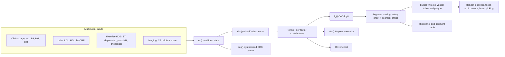

# System Architecture

CardioScope 3D is a client-side single-page application. There is no backend: all prediction, scoring and rendering happen in the browser, so patient data never leaves the device.

## High-level view

## Layers

| Layer | Responsibility | Where in `index.html` |
|-------|----------------|-----------------------|
| Input layer | Sliders, checkboxes, presets, what-if toggles | `F`, `C`, `PR`, `rd()`, `sim()` |
| Prediction layer | Additive logistic model and explainability terms | `terms()`, `lg()`, `r10()` |
| Mapping layer | Turns one patient-level logit into per-segment scores | `VS`, `build()` |
| 3D layer | Heart mesh, vessel tubes, plaque, lighting, camera, picking | `D()`, `H()`, `build()`, `loop()` |
| Presentation layer | Risk summary, driver bars, ECG, tooltips, theme | `upd()`, `ecg()`, `pick()` |

The prediction layer exposes only two functions, `lg(v)` and `r10(v)`, and takes a flat object of patient values. Replacing them with a trained model needs no change to the other layers.

## Data flow for one update

1. A user changes a slider, preset or what-if option, which fires `upd()`.
2. `rd()` reads every control into a patient object `v0`. `sim()` copies it and applies any ticked interventions to give the projected patient `v`.
3. `lg(v)` returns the CAD logit and `r10(v)` the 10-year risk. `terms(v)` returns the per-factor contributions used for the driver chart.
4. For each of the 9 vessel segments, the score is `sigmoid(logit + artery offset + segment offset)`.
5. `build()` clears the vessel group and regenerates every tube. Segment colour, tube radius and plaque follow the score.
6. The panel, table, projection text and ECG are redrawn, and the render loop keeps animating.

## 3D scene

- **Heart:** a unit sphere whose vertices are remapped by `D()` (a taper toward the apex plus width and depth scaling), then tilted to the left.
- **Arteries:** each vessel is a list of (longitude, latitude) points. `H()` maps them onto the same deformed surface, slightly outside it, and a Catmull-Rom curve is sampled into 3 tube segments (1 for the left main).
- **Heartbeat:** the group scale pulses with `sin(phase)^3`, where phase advances at the patient's heart rate.
- **Camera:** a custom orbit camera driven by pointer events (drag to rotate, wheel to zoom) with preset views.
- **Picking:** a Three.js raycaster against the vessel meshes drives the hover tooltip and detail box.

## Design decisions

- **Client-side only.** Keeps the demo deployable as one static file and keeps health data on the user's device.
- **Transparent model over black box.** An additive logit makes every prediction explainable term by term, which suits a visualisation-first tool.
- **Model isolated behind two functions.** Training a better model is an upgrade, not a rewrite.
- **Procedural geometry.** No large 3D assets, so the page loads quickly and runs on phones.

## Dependencies

- Three.js r128, loaded from cdnjs
- Google Fonts (Fraunces, Instrument Sans) with system-font fallbacks

## Known constraints

- Internet access is needed on first load for the CDN scripts and fonts.
- WebGL is required.
- The 3D heart is stylised, not patient-specific imaging.
